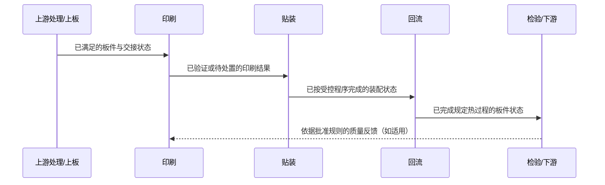

# SMT Equipment, Process, And Operation Concepts

This reference explains equipment classes and process relationships. It does not assert that every production line contains every class or that any named Southern Machinery model has a particular feature. Use current equipment documentation for model-specific descriptions.

## Equipment-Class Cards

| Equipment class | Process role | Conceptual input -> output | Structure/principle focus | Operation focus |
| --- | --- | --- | --- | --- |
| Board handling | Present, transfer, buffer, invert, or route boards where configured. | Board/state -> positioned board/state | Conveyance, support, sensing, transfer decision | Board support, width/clearance verification, handoff status |
| Stencil printer | Deposit solder paste at defined PCB locations. | PCB + stencil + paste -> printed PCB | Board support, stencil alignment, paste-transfer action, inspection point | Material condition, alignment, first-article verification |
| Solder-paste inspection where configured | Measure or review printed-paste characteristics according to the installed method. | Printed PCB -> result/data | Imaging/measurement, program/result logic | Program selection, result review, feedback path |
| Placement system | Pick, identify/align where equipped, and place components. | Supplied components + PCB/program -> populated PCB | Feeders, pickup/placement head, motion, sensing/vision concept, waste path | Feeder setup, program/revision control, component verification |
| Reflow system | Apply a validated thermal process to form solder joints. | Populated PCB + validated profile -> soldered PCB | Transport, controlled thermal zones, sensing/control, cooling concept | Profile authorization, board support, process-record review |
| Post-process inspection where configured | Detect or classify defined visible, dimensional, soldering, or assembly conditions. | Soldered PCB -> result/data | Imaging/measurement, program/result logic, review loop | Program/revision control, result disposition, feedback path |
| Buffer, unloader, and downstream interface | Decouple flow or hand boards to the next documented process. | Board/state -> queued, unloaded, or handed-off board | Storage/transfer logic, sensing, interface state | Queue status, magazine/receiver readiness, handoff confirmation |

Supporting equipment can include cleaning, marking, depaneling, storage, test integration, or material handling when the documented line requires it. Identify these as `可选` or `待确认` until the actual configuration is known.

## Parameter Categories, Not Invented Setpoints

| Area | Parameter category | Why it matters | Verify through |
| --- | --- | --- | --- |
| Board transfer | Board support, transport condition, interface/handoff state | Affects physical handling and station readiness. | Current manual, approved setup record, observed handoff result |
| Printing | Material condition, alignment, deposit-transfer controls | Affects the printed condition delivered to placement and soldering. | Approved process record and first-article/inspection evidence |
| Placement | Component supply, program revision, recognition/alignment, placement-force or motion categories where documented | Affects whether the intended component reaches the intended location under the approved program. | Approved program, feeder verification, first-article and inspection evidence |
| Reflow | Authorized profile, transport, thermal-control categories | Affects the documented thermal process and downstream solder-joint assessment. | Approved profile/process record and qualified verification method |
| Inspection | Program revision, acceptance logic, review/disposition path | Affects the consistency and traceability of a result. | Approved inspection program and quality procedure |

Do not supply a numerical setting, temperature profile, speed, pressure, dimension, or tolerance unless the current source supports both the value and its applicability to the learner's board, materials, and process.

## Operating Checkpoints

Use the current site procedure and manual to populate a specific checklist. At a conceptual level, organize a learning card as follows:

| Stage | Confirm | Record or escalate when |
| --- | --- | --- |
| Before start | Authorized product/program version, safe condition, required materials, board path, downstream readiness | Documentation is absent, a version is inconsistent, or a safety condition is not satisfied |
| Changeover | Board/component/process changes, line configuration, affected inspection or traceability rules | The change does not match approved records or requires engineering authorization |
| First article | The approved check method and result disposition | Result is outside the approved condition or cannot be verified |
| Production | Handoff status, quality signals, material state, abnormal events | A trend, alarm, stoppage, or quality result needs documented response |
| End or pause | Material/board status, safe state, records, and next-shift handoff | Board state, recipe state, or fault disposition is unclear |

## Coordination View

The messages are process-state concepts, not proof of a particular communications protocol or installed station. Confirm actual interface signals, quality feedback, and routing rules from current line documentation.
