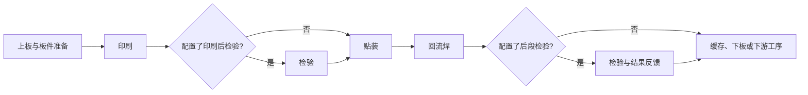
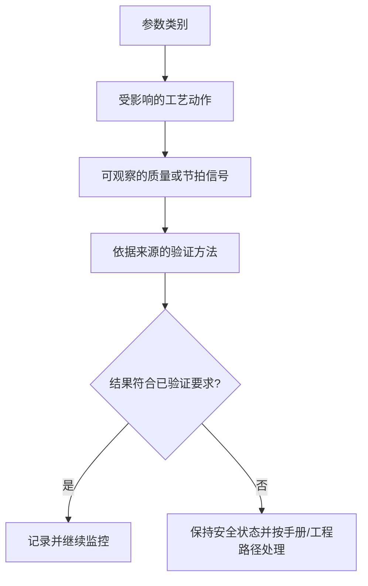
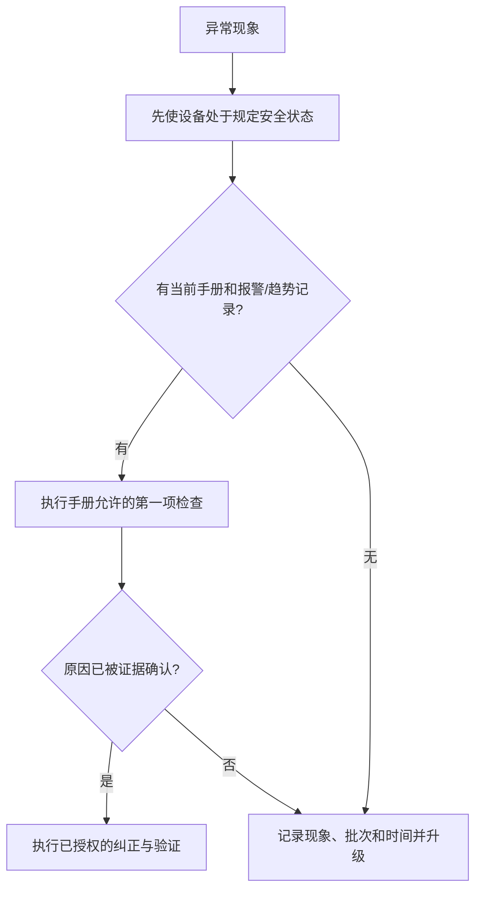

# Visual Language For SMT Learning

Each visual must answer one operational question. Do not decorate pages with unlabeled machine silhouettes or imply that a conceptual schematic is a specific Southern Machinery model.

## Visual Selection Map

| Learner question | Preferred diagram | Minimum labels |
| --- | --- | --- |
| What is the route through the line? | Process flow | Station class, board direction, optional/required/`待确认` state |
| What is inside a station conceptually? | Structure or mechanism map | Input, actuator/process element, sensing/check, output |
| Which material or signal moves? | Material/control flow | Board, paste, component, recipe/state, inspection result |
| Why does a parameter matter? | Causality map | Parameter category, affected process, symptom/risk, verification |
| How do I respond to a symptom? | Fault tree | Safe state, observed symptom, first source-backed check, escalation |
| What should I maintain? | Maintenance card | Object, approved task type, record evidence, manual/qualified-person boundary |
| Where do stations depend on each other? | Coordination swimlane | Upstream condition, handoff, downstream condition, feedback loop |

## Diagram Rules

- Put the evidence label in the title: `概念示意`, `已验证资料`, or `待确认`.
- Use arrows only for a named flow: board movement, material, information, quality decision, or escalation.
- Mark any optional station as `可选`, and any unverified station as `待确认`; do not silently place it in the line.
- Limit a single teaching diagram to one central question. Split a dense diagram into a process map and a separate mechanism or causality map.
- Never label an unverified numerical value, model name, certification, or exact maintenance interval.

## Editable Process Template



Use this as a `概念示意`. Replace labels only after confirming the actual configuration. A real line can add, remove, reorder, or bypass stations according to its documented process.

## Parameter-Causality Template



## Fault-Tree Template



## Source-Grounded Image Brief

When a raster illustration is needed, write a brief before generating or selecting it:

```markdown
### Visual brief: [topic]
- Purpose: [the learner question this visual answers]
- Evidence label: [已验证资料 / 概念示意 / 待确认]
- Source: [current file path, page/slide, or `none - conceptual schematic`]
- Visible facts to retain: [only items plainly supported by the source]
- Required labels: [short, source-backed labels]
- Exclusions: [no model number, value, certification, or hidden configuration unless verified]
```

If the image cannot be made source-grounded, use an editable conceptual diagram instead.
